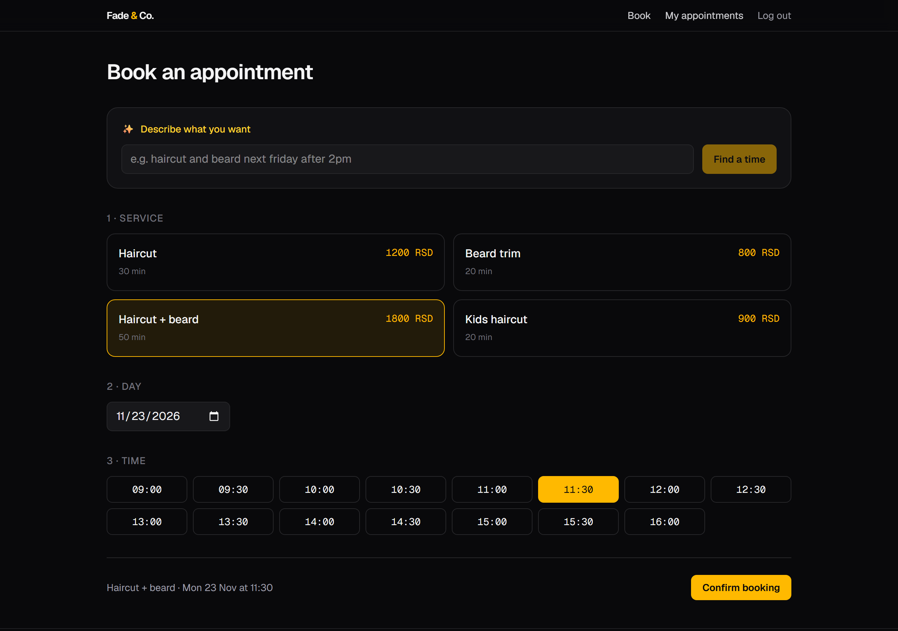

# Fade & Co. — barbershop booking

A full-stack appointment booking app for a barbershop: customers sign up, pick a service and a free time slot, and manage their bookings; the owner sees the daily schedule. Customers can also just **type what they want** ("haircut and beard next friday after 2pm") and an AI step finds matching free slots.

**Live demo:** _add your Vercel URL here_



## Features

- **Accounts & sessions**: email + password sign-up and login, bcrypt-hashed passwords, DB-backed sessions in an `httpOnly` cookie.
- **Real availability**: slots come from opening hours, service length and existing bookings, computed in the salon's timezone (`Europe/Belgrade`), with DST handled correctly.
- **No double bookings**: booking runs in a Postgres transaction with a table lock, and the slot is checked again inside it. Two people clicking the same time at the same moment get one booking and one `409`.
- **My appointments**: upcoming and past bookings, with **optimistic cancel** (the UI updates instantly and rolls back if the server refuses).
- **Admin schedule**: day view of all bookings for the owner (role-based access).
- **AI booking**: free text → service, day and time window, using the Claude API with structured output. The model only *interprets* the request: availability still comes from our own code, so the AI can never invent a slot or overbook.

## Tech stack

| Layer | Choice |
|---|---|
| Framework | Next.js 16 (App Router, Route Handlers), React 19, TypeScript |
| Data fetching | TanStack Query v5 (query keys, invalidation, optimistic updates) |
| Styling | Tailwind CSS v4 |
| Database | PostgreSQL: plain SQL through `pg`, and [PGlite](https://pglite.dev) (Postgres in WASM) for local dev and tests |
| Validation | Zod, on every API input |
| AI | Anthropic Claude API (`@anthropic-ai/sdk`), structured output |
| Tests | Vitest (unit), Playwright (end-to-end), run on GitHub Actions |
| Hosting | Vercel + Neon Postgres |

## Design decisions

- **Plain SQL instead of an ORM.** The schema is small, and readable SQL makes the locking and overlap queries explicit. See [`src/db/schema.ts`](src/db/schema.ts) and [`src/lib/booking.ts`](src/lib/booking.ts).
- **Zero-setup local database.** Without `DATABASE_URL`, the app starts PGlite, a real Postgres engine compiled to WASM, so `npm install && npm run dev` just works. In production the same SQL runs on Neon.
- **The slot logic is a pure function.** [`availableSlots()`](src/lib/slots.ts) takes the date, duration, existing bookings and "now", so it is unit tested without a DB or a mocked clock, including the DST switch.
- **The server is the source of truth.** The client never decides availability. `POST /api/appointments` recomputes the slots inside the transaction and rejects anything off the grid, in the past or already taken.
- **Sessions in the DB, not JWTs.** Logout and revocation actually work. Only a SHA-256 hash of the token is stored, so a leaked DB dump can't be used to log in.
- **AI is optional and kept in check.** Without an API key the feature turns itself off. AI output is validated (does the service exist, is the date well formed) before it is used, and the endpoint needs a login so strangers can't spend API credits.

## Getting started

```bash
npm install
cp .env.example .env.local   # optional: ADMIN_EMAIL / ADMIN_PASSWORD / ANTHROPIC_API_KEY
npm run dev
```

Open http://localhost:3000. Data is stored in `./.pglite`; delete that folder to reset.

To get an admin account, set `ADMIN_EMAIL` and `ADMIN_PASSWORD` in `.env.local` and restart. That user is created (or promoted) on startup.

## Tests

```bash
npm test            # Vitest: slot + timezone logic
npm run test:e2e    # Playwright: builds the app and runs it against a fresh in-memory database
```

The end-to-end tests cover: the auth redirect, a wrong password, the full book → view → cancel flow, a slot disappearing for other users, the API rejecting a double booking, the AI suggestion UI (with `/api/ai/parse` mocked), and admin-only access.

## Deploying to Vercel

1. Push this repo to GitHub.
2. Create a free Postgres database on [Neon](https://neon.tech) (or add Neon from the Vercel Marketplace) and copy the **pooled** connection string.
3. Import the repo in Vercel and set the environment variables:
   - `DATABASE_URL`: the Neon connection string
   - `ADMIN_EMAIL`, `ADMIN_PASSWORD`: your admin login
   - `ANTHROPIC_API_KEY`: optional, turns on AI booking
4. Deploy. Tables and the service list are created automatically on the first request.

## Project structure

```
src/
  app/            pages (App Router) and API route handlers under app/api
  components/     client components (booking flow, lists, forms)
  hooks/          TanStack Query hooks and query keys
  db/             database connection (pg / PGlite) and the SQL schema
  lib/            auth, booking rules, slot calculation, time zones, AI
e2e/              Playwright tests
```
